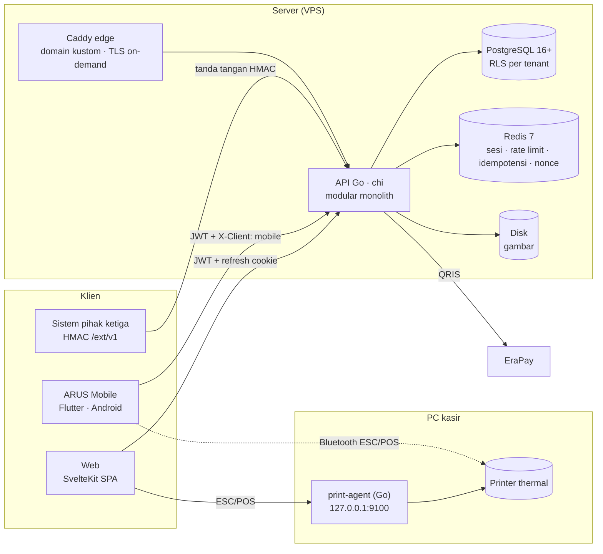

<div align="center">


```text
 █████╗ ██████╗ ██╗   ██╗███████╗
██╔══██╗██╔══██╗██║   ██║██╔════╝
███████║██████╔╝██║   ██║███████╗
██╔══██║██╔══██╗██║   ██║╚════██║
██║  ██║██║  ██║╚██████╔╝███████║
╚═╝  ╚═╝╚═╝  ╚═╝ ╚═════╝ ╚══════╝
 POS & ERP ritel · multi-tenant · multi-cabang
```

**Cepat di kasir. Rapi di stok. Jujur di angka.**


[Fitur](#-fitur) · [Arsitektur](#-arsitektur) · [Quickstart](#-quickstart) · [Mobile](#-arus-mobile-android) · [API](#-api-eksternal--portal-developer) · [Status](#-status--roadmap) · [Deploy](#-deploy) · [Docs](#-dokumentasi)

</div>

---

```console
$ arus status
  backend   Go modular monolith ........ ±30 modul · ±270 endpoint · 89 migration
  database  PostgreSQL + RLS per tenant . tanpa stored procedure bisnis
  web       SvelteKit 3 SPA ............. kasir modern + klasik · laporan · SIAK
  mobile    Flutter (Android) ........... kasir lengkap · struk Bluetooth · rilis Play
  printer   print-agent Go (ESC/POS) .... kurir RAW di PC kasir
  go-live   pilot 1 toko ritel .......... rencana mulai 1 November 2026
```

> [!NOTE]
> **ARUS sedang dikembangkan aktif.** Target pertama: go-live **pilot di satu toko ritel**. Kasir web praktis lengkap, kasir Android sudah bisa dipakai berjualan (termasuk cetak struk Bluetooth). Sisa jalur kritis ada di luar layar kasir: import katalog, backup teruji, spec test, dan CI. Lihat [Status & Roadmap](#-status--roadmap).

## Apa itu ARUS?

**Point of Sale + ERP ringan** untuk usaha ritel satu atau banyak cabang. Satu instalasi melayani banyak bisnis (*multi-tenant*); data tiap bisnis terisolasi di server **dan** di database.

Dibangun ulang dari nol untuk menggantikan sistem lama (CodeIgniter 4 + Node.js + MySQL). Sistem lama hanya jadi referensi aturan bisnis. **Tidak ada migrasi data**: toko mulai lewat *onboarding* (import barang, saldo awal stok, saldo awal piutang/hutang).

| 🐛 Masalah di sistem lama | ✅ Jawaban ARUS |
|---|---|
| API tanpa autentikasi, tenant dari isian browser | Tenant, outlet, user **selalu dari token** di server + **Row Level Security** PostgreSQL |
| Transaksi tidak atomik, stok balapan antar kasir | Satu use-case = satu transaksi DB; stok = **ledger** dengan penjaga atomik |
| Uang disimpan sebagai `DOUBLE` | `NUMERIC(18,2)` uang, `NUMERIC(18,3)` qty; Go tanpa float |
| Harga dikirim browser dan dipercaya | **Harga dihitung server**; ubah harga wajib PIN penyetuju + audit |
| Aturan bisnis tersembunyi di trigger/SP | Aturan di service Go yang dites; nota tak pernah ditimpa (edit = revisi) |
| Kiriman ganda membuat nota ganda | **Idempotency-Key** di semua endpoint pembuat transaksi |

## ✨ Fitur

<table>
<tr><td valign="top" width="50%">

**🧾 Kasir (POS)**
- Keyboard-first, shortcut F1–F10; dua tampilan: **modern** `/kasir` dan **klasik** gaya desktop `/kasirb`
- Scan barcode, 16 slot pintasan barang, nota pending, katalog **>100 ribu barang** tetap cepat
- Bayar tunai, non-tunai, split, **kredit + DP**, **QRIS EraPay** (+ simpan paksa bila gateway tak terjangkau, dengan PIN penyetuju)
- Member, poin, kupon, salesman, biaya lain dinamis; peringatan stok kurang dan harga di bawah HPP
- **Shift kasir**: modal awal, hitung fisik per metode, selisih wajib catatan + PIN
- **Kas kecil** per shift, struk 58/80 mm, struk tutup shift, rekap harian
- Edit/batal nota lewat **revisi**, retur penjualan

</td><td valign="top">

**📦 Stok**
- Ledger append-only, 3 bucket: Display, Gudang, Retur
- Aman untuk banyak kasir menjual barang sama bersamaan
- Saldo awal + kunci tanggal mulai operasional
- **Opname** (sesi/langsung), **pecah satuan**
- **Mutasi** antar cabang/bucket (kirim → terima, selisih tercatat)
- Kartu stok dengan saldo berjalan

**🗂️ Master data**
- Item: kode, barcode, harga **per cabang**, **grosir bertingkat**, konversi satuan, gambar, deskripsi markdown
- Satuan, kategori, brand, principal, pemasok, salesman; riwayat harga jual/beli

</td></tr>
<tr><td valign="top">

**🛒 Pembelian & hutang**
- Tunai/kredit, diskon baris bertingkat, biaya lain
- **HPP rata-rata tertimbang per cabang**
- Edit/batal dengan revisi, retur beli dari bucket Retur
- Hutang pemasok: cicilan, pelunasan kolektif, aging; kredit pemasok

**👥 Pelanggan & keuangan**
- Member dengan **level berdasarkan poin**, ledger poin, **deposit** sebagai metode bayar
- Piutang: cicilan, pelunasan kolektif, aging, saldo awal
- Metode bayar per tenant dengan **MDR** (ditanggung toko/pelanggan) + aturan transaksi kecil

</td><td valign="top">

**📊 Laporan & dasbor**
- **Dasbor** "toko baik-baik saja?": KPI, tren, terlaris, per jam, shift, stok menipis, banding cabang & bulan lalu
- **Penjualan Langsung** real-time (SSE)
- Laporan penjualan (per faktur, detail, barang, kasir/rekonsiliasi laci, pelanggan, tanggal), pembelian, retur, hutang/piutang, master, nilai persediaan
- Ekspor **Excel + PDF** · rentang sampai 1 tahun · paginasi keyset (diukur di 330 rb nota)

**📚 Akuntansi (SIAK)**
- Bagan akun, periode, jurnal draf → posting immutable, buku besar, neraca saldo, laba rugi, neraca
- Kas & bank, rekonsiliasi bank, kas kecil, **tutup tahun**, jurnal otomatis dari transaksi

</td></tr>
<tr><td valign="top">

**🤖 HalloArus (AI hanya-baca)**
- Tanya angka toko ke Claude, ChatGPT, Gemini, atau Qwen (API key milik tenant; data pelanggan dianonimkan)
- Atau lewat **connector MCP** dari langganan Claude Anda
- Selalu dibatasi izin role pengguna

**💳 Paket langganan**
- Paket dinamis (FREE / PRO / FULL, dikelola Platform Admin): batas transaksi/hari, batas user, **modul per paket**
- Menu terkunci tampil bergembok → ajakan upgrade; bayar upgrade lewat QRIS EraPay

</td><td valign="top">

**🔐 Akses & keamanan**
- Login argon2id, refresh token berotasi, kunci login bertahap, lupa/reset password, verifikasi email
- Role & izin per menu (view/create/update/delete/approve), anti-eskalasi, akses per outlet
- **Audit log append-only** + tampilan konsol (level, cari, live tail, ekspor NDJSON)

**🛰️ Platform Admin** (terpisah, wajib 2FA TOTP)
- Tenant, paket, bahasa, "masuk sebagai" (diaudit), **hapus tenant permanen** dengan masa tunggu
- **Domain kustom / white label** per tenant (TLS on-demand), kredensial API eksternal
- **Checklist QA/QC** lintas aplikasi (web, platform, developer, mobile, print-agent)

</td></tr>
</table>

Antarmuka: tema Dreams Core (Tailwind v4), terang/gelap, **Indonesia · English · 日本語** (bahasa baru bisa ditambah dari Platform Admin), tab halaman yang menyimpan draf form. Simbol mata uang mengikuti bahasa; nilai tetap Rupiah.

## 🏗️ Arsitektur



| Lapisan | Teknologi |
|---|---|
| Backend | Go, `chi`, `pgx/v5`, `sqlc`, `goose`, `slog`, argon2id |
| Database | PostgreSQL 16+: RLS, FK komposit, UNIQUE; tanpa stored procedure bisnis |
| Cache | Redis 7: **tidak pernah** jadi sumber kebenaran stok atau uang |
| Web | SvelteKit 3 (SPA, `adapter-static`), Tailwind v4, bits-ui, TanStack Query, zod |
| Mobile | Flutter (Android), Riverpod, go_router, dio, `decimal`; auth native via `X-Client: mobile` |
| Cetak | print-agent Go tanpa dependensi (spooler RAW); mobile: Bluetooth SPP ESC/POS |
| Deploy | Docker Compose (Postgres + Redis), binary Go via systemd, web statis di Apache/Nginx, Caddy untuk domain kustom |

**Invarian di semua modul:** tenant/outlet dari token · satu use-case satu transaksi · harga dihitung server · stok = ledger · idempotensi · kunci bisnis dijaga DB · uang tanpa float · aturan bisnis di service Go yang dites · tanpa secret di repo. Uraian lengkap: [`AGENTS.md` §3](AGENTS.md); desain data: [`docs/ARCHITECTURE.md`](docs/ARCHITECTURE.md).

## 🚀 Quickstart

**Prasyarat:** Go 1.27+, [Bun](https://bun.sh) 1.4+, Docker + Compose, [`goose`](https://github.com/pressly/goose) (`go install github.com/pressly/goose/v3/cmd/goose@latest`). `sqlc` hanya bila mengubah `queries.sql`. Mobile: Flutter 3.47 + JDK 17 + Android SDK ([`docs/DEV-ENV.md`](docs/DEV-ENV.md)). Versi ringkas: [`docs/RUN.md`](docs/RUN.md).

```bash
git clone https://github.com/erayadigitalsolusindo/arus.git && cd arus

# 1. PostgreSQL (127.0.0.1:5433) + Redis (127.0.0.1:6380)
cp source/deploy/.env.example source/deploy/.env
docker compose -f source/deploy/docker-compose.yml --env-file source/deploy/.env up -d

# 2. Konfigurasi API: samakan password dengan deploy/.env, JWT_SECRET ≥ 32 karakter
cp source/backend/.env.example source/backend/.env

# 3. Migration (URL pemilik skema dari backend/.env)
export MIGRATE_DATABASE_URL='postgres://...'
goose -dir source/backend/db/migrations postgres "$MIGRATE_DATABASE_URL" up

# 4. API → http://localhost:8080/healthz
go -C source/backend run ./cmd/api

# 5. Web → http://localhost:5200  (terminal lain)
cd source/web && cp .env.example .env && bun install && bun run dev
```

Buka <http://localhost:5200> → **Register** untuk membuat tenant dan Owner pertama. Di dev email tidak dikirim; tautan verifikasi/reset hanya tercatat di log API. Sesudah `git pull`: terapkan migration baru **dan restart API**.

| Opsional | Perintah |
|---|---|
| Data contoh | `cd source/backend && go run ./cmd/seeddemo` |
| Data demo 1 bulan (tenant lengkap + akuntansi) | `go run ./cmd/seedlive` (lihat [`docs/DEV-ENV.md`](docs/DEV-ENV.md)) |
| Penjualan dummy untuk laporan | `go run ./cmd/seedsales` |
| Mobile | `cd source/mobile && flutter pub get && flutter run` |
| Print-agent | [`source/print-agent`](source/print-agent) + [`PC-KASIR.md`](source/deploy/PC-KASIR.md) |

<details>
<summary><b>Detail: dua koneksi database, Platform Admin, catatan instalasi</b></summary>

- **Dua URL database disengaja.** `MIGRATE_DATABASE_URL` = pemilik skema (khusus goose; melewati RLS). `DATABASE_URL` = role `aciraba_app` yang dipakai API: bukan pemilik dan tanpa BYPASSRLS, sehingga RLS selalu berlaku. Role dibuat otomatis oleh `source/deploy/initdb/01-app-role.sh` saat volume Postgres pertama dibuat.
- **Jangan `source` file `.env` utuh**: nilai berspasi (mis. `SMTP_FROM`) rusak. `export` variabel yang perlu saja.
- **Platform Admin:** isi `PLATFORM_SETUP_TOKEN` (≥ 32 karakter), restart API, buka `/platform/setup` untuk membuat admin pertama (wajib daftar 2FA). **Hapus token itu setelah selesai.**
- Folder `docker/` di root = compose mesin dev pengembang (`eds_postgres`/`eds_redis`), **bukan** compose ARUS. Pakai `source/deploy/docker-compose.yml`.

</details>

<details>
<summary><b>Konfigurasi environment (<code>source/backend/.env</code>)</b></summary>

| Variabel | Keterangan |
|---|---|
| `APP_ENV` | `development` / `production` |
| `HTTP_ADDR` | alamat listen API, mis. `:8080` (cocok dengan `VITE_API_URL` di web) |
| `DATABASE_URL` | koneksi runtime (role `aciraba_app`) |
| `MIGRATE_DATABASE_URL` | koneksi pemilik skema, khusus goose |
| `REDIS_URL` | koneksi Redis |
| `JWT_SECRET` | wajib, ≥ 32 karakter. **Menggantinya membuat semua PIN penyetuju dan rahasia 2FA tidak berlaku** |
| `CORS_ORIGINS` | origin SPA yang diizinkan (juga penjaga CSRF) |
| `APP_BASE_URL` | alamat SPA untuk tautan email; wajib `https://` di luar dev |
| `SMTP_HOST/PORT/USER/PASS/FROM` | email; kosong di dev = hanya log; **wajib di produksi** |
| `UPLOAD_DIR` | folder gambar (bawaan `./data/uploads`; produksi: volume yang dicadangkan) |
| `TRUST_PROXY` | `true` hanya di belakang reverse proxy tepercaya (mengaktifkan `X-Forwarded-For`; **wajib** agar allowlist IP API eksternal membaca IP asli) |
| `PLATFORM_SETUP_TOKEN` | membuat Platform Admin pertama; hapus setelah dipakai |
| `ERAPAY_PLATFORM_API_KEY` | kunci EraPay untuk checkout upgrade paket |
| `CUSTOM_DOMAIN_TARGET` | target CNAME untuk domain kustom tenant (bawaan: host `APP_BASE_URL`) |

Web (`source/web/.env`): `VITE_API_URL` = alamat API; `VITE_PRIMARY_HOSTS` = host utama (selain itu dianggap domain kustom, API lewat origin yang sama).

</details>

<details>
<summary><b>Menjalankan test</b></summary>

```bash
# Backend: test integrasi di-skip bila tiga variabel ini kosong
export TEST_DATABASE_URL=...        # = DATABASE_URL (aciraba_app)
export TEST_ADMIN_DATABASE_URL=...  # = MIGRATE_DATABASE_URL (pemilik)
export TEST_REDIS_URL=...           # = REDIS_URL
(cd source/backend && go vet ./... && go test -count=1 ./...)

# Web
(cd source/web && bun run check && bun run build)

# Print-agent
(cd source/print-agent && go test ./...)

# Mobile (tanpa server, fake HTTP)
(cd source/mobile && flutter analyze && flutter test)
```

Test membuat dan membersihkan tenant uji sendiri; pakai database dev, bukan produksi. Banyak test **konkuren** (mis. 25 kasir menjual stok 10 → tepat 10 berhasil), jangan dilewati. CI belum ada, jalankan semuanya sebelum push.

</details>

<details>
<summary><b>Troubleshooting</b></summary>

| Gejala | Penyebab umum |
|---|---|
| API menolak start | `JWT_SECRET` < 32 karakter, atau `SMTP_HOST` kosong di mode production |
| `/healthz` → `redis: down` | password Redis di `backend/.env` ≠ `deploy/.env` |
| UI "Server unreachable" | API mati / `VITE_API_URL` ≠ `HTTP_ADDR` / origin belum ada di `CORS_ORIGINS` |
| Web gagal start di port 5200 | port dipakai proses lain (`strictPort` aktif) |
| Rute/kolom baru tak ada setelah `git pull` | migration belum diterapkan atau API lama belum di-restart |
| Test integrasi ter-skip | `TEST_*` belum diatur |
| Kasir tak bisa simpan nota (`SHIFT_REQUIRED`) | shift belum dibuka |
| Struk tak tercetak lewat agent | agent belum jalan atau origin web belum terdaftar ([`PC-KASIR.md`](source/deploy/PC-KASIR.md)) |
| Login berputar di produksi | Cloudflare SSL *Flexible* (harus *Full strict*), atau web & API beda domain induk |
| PIN/2FA tiba-tiba tak valid | `JWT_SECRET` diganti; atur ulang PIN, minta admin lain reset 2FA |
| Allowlist IP API eksternal menolak semua | `TRUST_PROXY` belum `true` di belakang proxy |
| Build Android gagal "Could not close incremental caches" | `kotlin.incremental=false` di `android/gradle.properties` (proyek di drive D:, cache Flutter di C:) |

</details>

## 📱 ARUS Mobile (Android)

Kasir native (Flutter) dengan API Go yang sama dengan web. Aturan lengkap: [`source/mobile/AGENTS.md`](source/mobile/AGENTS.md).

- **Kasir lengkap**: katalog bergambar, scan kamera + pemindai HID, keranjang dengan harga dari server, bayar tunai/non-tunai/split/**kredit**, **QRIS EraPay**, member & tukar poin, salesman, ubah harga dengan PIN penyetuju, biaya lain, nota pending, pintasan barang, filter kategori
- **Shift**: buka/tutup dengan hitung fisik, kas kecil, Penjualan hari ini, pindah cabang
- **Cetak struk Bluetooth** (SPP, ESC/POS 58/80 mm), cetak ulang tercatat
- Tema terang/gelap/ikut sistem, latar lautan beranimasi, **id · en · ja**, skala teks
- Belum: retur di mobile, kasir offline; printer BLE-only belum didukung

**Dua jalur distribusi** (flavor Android):

| Flavor | Untuk | Perintah |
|---|---|---|
| `sideload` (bawaan) | APK diunggah via Platform Admin; **pembaruan otomatis** (cek versi → unduh → verifikasi SHA-256 → pasang) | `flutter build apk --release` |
| `play` | Google Play: tanpa pembaruan mandiri dan tanpa izin pemasang APK | `flutter build appbundle --release --flavor play` |

> [!IMPORTANT]
> Naikkan `version:` di `pubspec.yaml` setiap rilis (angka setelah `+` = `versionCode`, tak boleh dipakai ulang). Pemasangan dari Play ditandatangani kunci Google, jadi tidak bisa menimpa APK sideload (dan sebaliknya).

Kebijakan privasi (dibutuhkan Play): `/privacy`.

## 🔌 API eksternal & portal developer

Integrasi server-ke-server lewat gateway **`/ext/v1/*`** dengan tanda tangan **HMAC-SHA256** (`X-Api-Key`, `X-Timestamp`, `X-Nonce`, `X-Signature`).

- Berlapis: batas per-IP → kredensial → **allowlist IP/CIDR** → tanda tangan → nonce sekali pakai (Redis) → rate limit per kredensial
- Bekerja sebagai **akun layanan** dengan izin role-nya; semua handler, izin, audit, dan idempotensi dipakai apa adanya
- Kredensial dikelola Platform Admin (secret tampil sekali, rotasi dengan masa transisi, kedaluwarsa)
- Portal dokumentasi publik **`/developers`**: katalog dari router, contoh cURL/Node/Python/PHP/Go, playground tanda tangan, tombol "Coba", **white label** per domain

## 📁 Struktur repo

```text
.
├── AGENTS.md              # pintu masuk agen: keputusan terkunci, invarian, peta dokumen
├── CLAUDE.md              # pointer ke AGENTS.md
├── .agent/SESSION.md      # status sesi terkini dan langkah berikutnya
├── docs/                  # PRD, ROADMAP, ARCHITECTURE, DEV-ENV, RUN, LEGACY, SESSION-LOG
├── reference/             # acuan visual template UI (tidak ikut git)
├── docker/                # compose mesin dev pengembang, bukan compose ARUS
└── source/
    ├── backend/           # Go: cmd/{api,seed*}, internal/<modul>, db/migrations, sqlc.yaml
    ├── web/               # SvelteKit SPA: routes (app)|(pos)|platform|developers, lib/i18n, lib/pos
    ├── mobile/            # Flutter (ARUS Mobile): lib/{core,features,shell}, flavor sideload|play
    ├── print-agent/       # Go: kurir struk ESC/POS untuk PC kasir
    ├── tests/spec/        # spec test perhitungan (belum terisi)
    └── deploy/            # compose dev, PC-KASIR.md, aapanel/, manual/, edge/ (Caddy)
```

Modul backend (`source/backend/internal/`): `auth` `authz` `iam` `audit` `outlet` `catalog` `item` `member` `voucher` `wallet` `paymentmethod` `posshortcut` `sales` `shift` `receivable` `stock` `purchasing` `payable` `approval` `accounting` `reports` `dashboard` `live` `ai` `erapay` `plan` `subscription` `extapi` `platformadmin` dan lainnya. Setiap modul: `service.go` · `handler.go` · `queries.sql` · `*_test.go`.

## 📊 Status & Roadmap

| Fase | Isi | Status |
|---|---|---|
| 0 | Fondasi (repo, Docker, Go, migration, SPA shell) | ✅ |
| 1 | Aturan bisnis tertulis & spec test yang disetujui | ⏳ Belum |
| 2 | Auth, tenant, RLS, role & izin, audit | ✅ |
| 3 | Master data, item, member, metode bayar | 🟡 Diskon item & **import Excel/CSV** belum |
| 4 | Stok: ledger, saldo awal, opname, mutasi, pecah satuan, kartu stok | ✅ |
| 5 | Kasir: nota, kredit, revisi, retur, piutang, shift, struk | 🟡 Sisa catatan per baris, offline |
| 6 | Pembelian, retur beli, hutang | 🟡 Saldo awal hutang, pembatalan pembayaran, PO belum |
| 7 | Laporan | 🟡 Penjualan, pembelian, retur, hutang/piutang, master, persediaan sudah; sisanya bertahap |
| 8 | Modul opsional: akuntansi, AI, payment gateway, API eksternal | 🟡 SIAK, HalloArus, EraPay QRIS, API HMAC berjalan; resto/KDS belum |
| 9 | Wizard onboarding & go-live | ⏳ Belum |
| 10 | Kasir mobile Android | 🟡 Berjalan + siap Play; sisa retur dan uji lapangan |
| Platform | Paket langganan, domain kustom, QA/QC, hapus tenant | 🟡 Berjalan; domain kustom belum diuji end-to-end di edge nyata |

**Jalur kritis go-live pilot**

- [ ] Import barang + saldo awal stok dari Excel/CSV (katalog pilot >100 ribu barang)
- [ ] Backup terjadwal ke luar server + satu kali uji restore
- [ ] Spec test penjualan untuk kasus tersering, disetujui pemilik produk
- [ ] CI GitHub Actions (`go test`, `bun run check`)
- [ ] Gladi bersih di PC kasir toko: shift, struk di printer asli, retur, piutang

**Batasan:** kasir belum bisa offline · Syarat Layanan & Kebijakan Privasi belum ditinjau konsultan hukum (banner draf sudah dihapus atas keputusan pemilik produk) · email verifikasi belum memblokir login dan dikirim tanpa antrean/retry.

Status rinci yang selalu terbaru: [`.agent/SESSION.md`](.agent/SESSION.md) dan [`docs/ROADMAP.md`](docs/ROADMAP.md). Bila README berbeda dengan keduanya atau dengan [`AGENTS.md`](AGENTS.md), **ikuti mereka**.

## 🌐 Deploy

| Jalur | Panduan | Kondisi |
|---|---|---|
| aaPanel (Apache/Nginx) + systemd | [`DEPLOY-AAPANEL.md`](source/deploy/aapanel/DEPLOY-AAPANEL.md) | ✅ Diuji di server nyata |
| Manual (nginx + certbot + systemd) | [`DEPLOY-MANUAL.md`](source/deploy/manual/DEPLOY-MANUAL.md) | Belum diuji di server nyata |
| PC kasir (printer thermal + print-agent) | [`PC-KASIR.md`](source/deploy/PC-KASIR.md) | ✅ Diuji dengan printer fisik |
| Domain kustom per tenant (Caddy edge) | [`DOMAIN-KUSTOM.md`](source/deploy/edge/DOMAIN-KUSTOM.md) | Belum dijalankan/diuji |

- Web (`arus.<domain>`) dan API (`arus-api.<domain>`) harus di bawah **satu domain induk** agar cookie refresh `SameSite=Lax` bekerja.
- Postgres, Redis, dan API hanya bind ke `127.0.0.1`. Jangan buka port 5433/6380/8080.
- Update: `bash ~/update-arus.sh` → git pull → build → **backup DB** → migration → ganti binary (lama disimpan `.prev`) → restart → cek `/healthz`; lalu `bash ~/cek-arus.sh`.
- Migration hanya maju. Rollback skema = pulihkan dari dump `pre-update-*.dump`.

> [!WARNING]
> Backup di disk server yang sama tidak menolong kalau servernya hilang. Simpan salinan di luar server, cadangkan juga `data/uploads` dan `.env`, dan **uji restore**. Backup yang belum pernah diuji restore belum bisa diandalkan.

## 📚 Dokumentasi

| Dokumen | Isi |
|---|---|
| [`AGENTS.md`](AGENTS.md) | Pintu masuk: keputusan terkunci, invarian, konvensi (per folder: `source/backend`, `source/web`, `source/mobile`) |
| [`.agent/SESSION.md`](.agent/SESSION.md) | Status terkini dan langkah berikutnya |
| [`docs/PRD.md`](docs/PRD.md) | Kebutuhan produk: APA & MENGAPA (ID `FR-POS-…`, dst.) |
| [`docs/ROADMAP.md`](docs/ROADMAP.md) | Fase dan kotak centang |
| [`docs/ARCHITECTURE.md`](docs/ARCHITECTURE.md) | Desain data, struktur repo, pemetaan template UI |
| [`docs/DEV-ENV.md`](docs/DEV-ENV.md) · [`docs/RUN.md`](docs/RUN.md) | Toolchain, akun demo · cara menjalankan ringkas |
| [`docs/LEGACY.md`](docs/LEGACY.md) · [`docs/SESSION-LOG.md`](docs/SESSION-LOG.md) | Referensi aturan bisnis lama · arsip riwayat sesi |

## 🤝 Kontribusi

- Baca `AGENTS.md` (dan `AGENTS.md` folder yang dikerjakan) sebelum mengubah kode.
- **Tabel bertenant baru** wajib punya `tenant_id`, `ENABLE ROW LEVEL SECURITY` + policy `tenant_isolation`, dan test isolasi.
- **Teks UI** selalu lewat kamus i18n `t('domain.kunci')` (id sumber + en + ja), tidak ditulis langsung di komponen.
- **Siap big data:** paginasi keyset, tanpa `OFFSET`/count besar; pencarian teks di bawah RLS memakai pola fungsi `SECURITY DEFINER` ([`source/backend/AGENTS.md`](source/backend/AGENTS.md)). Ukur query berat sebagai role `aciraba_app`, bukan pemilik.
- Setiap modul wajib test invarian (stok tidak minus, total nota, idempotensi, konkurensi).
- Jangan mengomit `.env`, kredensial, atau dump data pelanggan.

---

<div align="center">
<sub>© Eraya Digital Solusindo · Source-available: kode boleh dibaca dan dipakai untuk usaha sendiri, dilarang dijual ulang tanpa izin · Lihat <a href="LICENSE">LICENSE</a></sub>
</div>
